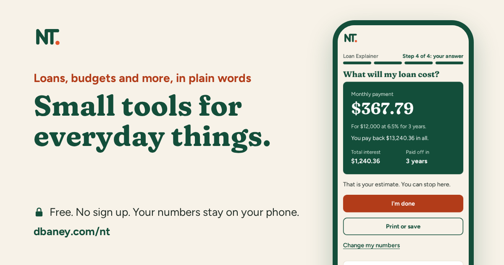
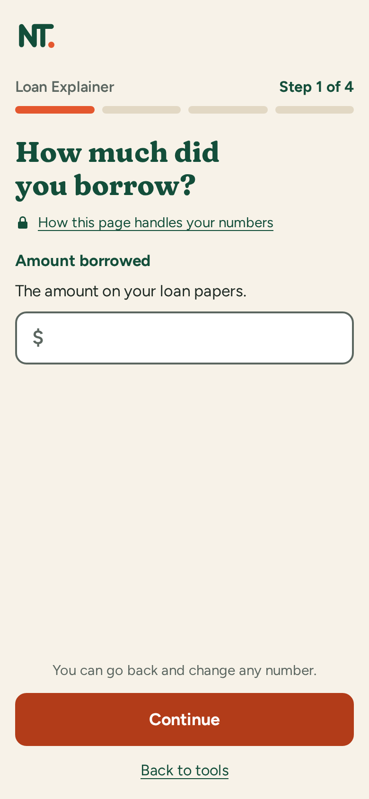
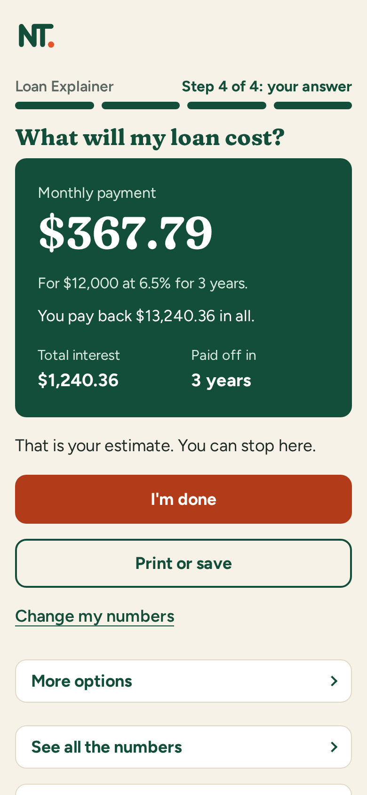
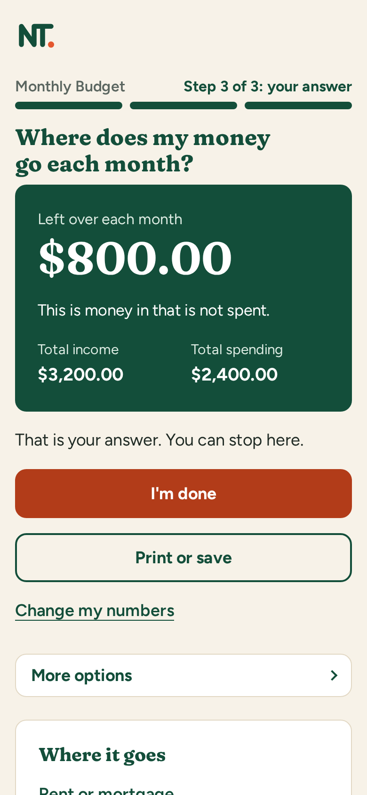

# NT

[](https://github.com/baney75/normie-tools/actions/workflows/ci.yml)
[](LICENSE)
[](https://dbaney.com/nt/)

**Small tools for everyday things.** Free, private calculators for the money questions people actually have, written in plain words for people with no tech background.

[](https://dbaney.com/nt/)

**Try it: [dbaney.com/nt](https://dbaney.com/nt/).** It installs to a phone's home screen and works offline.

## Why NT

Most calculators online are built for people who already know the words. NT is built for everyone else: someone anxious about money, someone older, someone with ADHD, someone on a phone with one free hand.

- **One question per screen.** Each tool asks one thing at a time, with a big Continue button in the same place on every step, and shows "Step 2 of 4" so you always know how far along you are.
- **Answer first.** The answer comes in one sentence and one big number, with the numbers it was based on. The detail waits behind a tap.
- **Private by design.** Everything runs in the page. Nothing you type is sent anywhere. There is no account. See [how we know](https://dbaney.com/nt/#/private).
- **Plain words.** Person-facing text aims at about a 6th grade reading level, with no jargon and no advice.
- **Accurate.** Money math uses whole cents, and every tool has its own accuracy suite.

## Tools

| Tool | The question it answers |
|---|---|
| [Loan Explainer](https://dbaney.com/nt/tools/loan-explainer/) | What will my loan cost? |
| [Mortgage Payment Explainer](https://dbaney.com/nt/tools/mortgage-payment-explainer/) | What will my house payment be? |
| [Student Loan Growth and Payoff](https://dbaney.com/nt/tools/student-loan-growth-and-payoff/) | When will my student loan be paid off? |
| [Loan Offer Compare](https://dbaney.com/nt/tools/loan-offer-compare/) | Which loan offer costs less to borrow? |
| [Monthly Budget](https://dbaney.com/nt/tools/monthly-budget/) | Where does my money go each month? |
| [Unit Converter](https://dbaney.com/nt/tools/unit-converter/) | Change cups, inches, pounds and more |

More tools are on the way. NT adds them one at a time, and only when they pass the same checks. The list lives in [`site/public/tools.json`](site/public/tools.json).

| One question per screen | The answer, in plain words | What is left each month |
|---|---|---|
|  |  |  |

## How it is built

- A static web app: [Vite](https://vite.dev/), React and TypeScript, in [`site/`](site/). It is served at `/nt/` and works offline through a service worker.
- Each tool's math lives in plain JavaScript modules under [`tools/<id>/calc.mjs`](tools/), with its own tests, so it can be checked apart from the screens.
- Each shipped tool also has its own page at `/nt/tools/<id>/` with its own title, description and link preview picture.

### Quality gates

A tool ships only when all of these pass, in CI and on every pull request:

- **Unit and accuracy tests** for the math and every screen (Vitest and Node's test runner).
- **Browser tests** in Chromium, WebKit and Firefox (Playwright): every question fits one phone screen, tap targets are 44px or larger, and pages pass axe accessibility checks.
- **Copy checks:** reading level, banned jargon, no clutter, no em or en dashes, privacy.
- **The evidence gate:** a first-time-user reviewer model and a design rubric read each screen the way a person would. A tool stays shipped only when it scores well on both. See [`tests/model-review/`](tests/model-review/) and [`scripts/check-evidence.mjs`](scripts/check-evidence.mjs).

Design decisions and the reasons behind them are recorded in [`docs/decisions.md`](docs/decisions.md). NT is built from research on real people; start at [`research/README.md`](research/README.md).

## Run it locally

Needs Node 22 or newer and Python 3.

```bash
npm ci                    # install everything
npm run build             # build the site into site/dist
npm test                  # every repo check
npm run test:site         # site unit tests
npm run test:e2e          # build, then browser tests in Chromium, WebKit and Firefox
```

Browser tests need browsers once: `cd site && npx playwright install --with-deps chromium webkit firefox`. Run one browser with `npm run test:e2e -- --project=chromium`. More commands are in [`site/README.md`](site/README.md).

To redraw the link preview pictures and install screenshots after a design change, serve a build at `/nt/` and run `node scripts/gen-share.mjs --site <url>`.

## Repository map

| Path | What it is |
|---|---|
| [`site/`](site/) | The NT web app |
| [`tools/`](tools/) | Each tool's math and accuracy tests |
| [`tests/`](tests/) | Shared fixtures and the model review harness |
| [`scripts/`](scripts/) | Repo checks and generators |
| [`docs/`](docs/) | Design rules, decisions and builder guides |
| [`research/`](research/) | Checked sources on attention, literacy, trust and money stress |
| [`brand/`](brand/) | Marks, wordmarks and color tokens |
| [`skills/`](skills/) | Add-ons that let an AI app use NT tools |
| [`plan/`](plan/) | The product plan and working notes |

## Contributing

Pull requests are welcome. Read [`CONTRIBUTING.md`](CONTRIBUTING.md) first, and [`AGENTS.md`](AGENTS.md) if you are an AI agent. Report security problems as described in [`SECURITY.md`](SECURITY.md).

## License

[Apache License 2.0](LICENSE). See [`NOTICE`](NOTICE) and, for why, [`docs/license-choice.md`](docs/license-choice.md).
